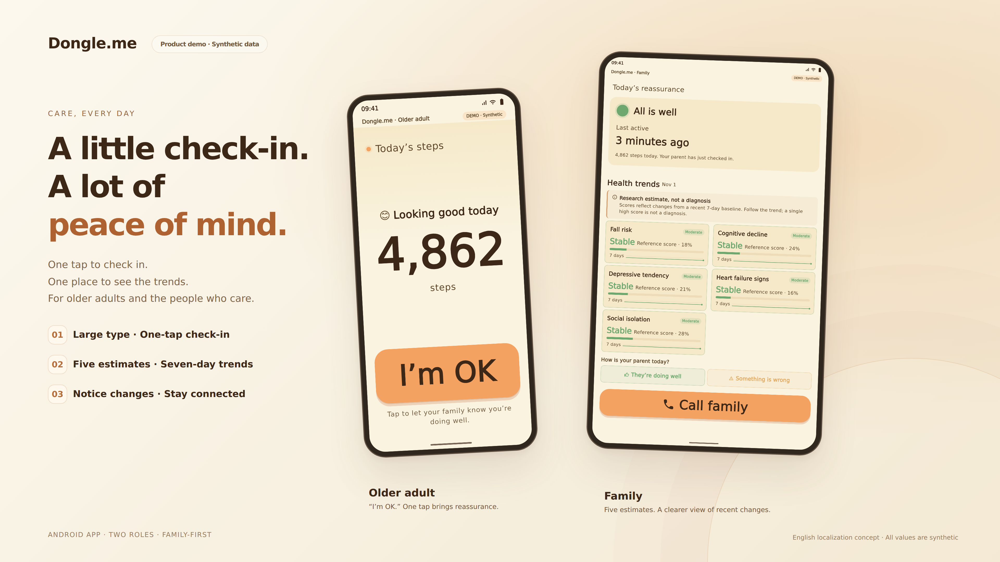

# Dongle.me

**Information bottleneck is the theoretical highlight; care for older adults living alone is the social purpose.**

**A little check-in. A lot of peace of mind.** A care prototype for older adults who live alone and the people who care about them: one-tap reassurance for older adults, and a separate view of recent changes for families.

[**Try the browser demo →**](https://hawever-renbo.github.io/dongle-me/) · [Six-screen gallery](https://hawever-renbo.github.io/dongle-me/assets/index.html) · [Theory & application](docs/INFORMATION_BOTTLENECK.md) · [Implementation status](docs/STATUS.md)



## Explore in one minute

1. Open the browser demo. No installation or account is needed.
2. Choose **English / 中文** to preview both roles.
3. Tap **I’m OK — preview check-in** to see the confirmation screen.
4. Switch **Stable trends / Changes to check** to compare family scenarios; scroll inside the screens.
5. Open the [Flutter UI excerpts](source/) and [implementation status](docs/STATUS.md) for technical context.

The browser demo is a screenshot-based interactive walkthrough built around the supplied Flutter screens. The check-in does not deliver a notification. It uses fixed synthetic fixtures and does not run a health prediction model. English localization and bilingual switching are concepts for a future Android release, not features claimed for the current APK.

## Theoretical highlight: from one T to multiple T stages

The project’s information bottleneck notation is **X → T → Y**: inputs X are represented through T while retaining information relevant to target Y. In the standard IB formulation, the trade-off is expressed as `min I(X; T) − β I(T; Y)`.

As clarified by the project owner on 2026-11-03:

| Research stage | Representation chain | Status |
| --- | --- | --- |
| Earlier work | **X → T → Y** | A single T was the working approach for an extended period |
| Recent exploration | **X → T₁ → T₂ → Y** | Trying at least one additional intermediate representation |
| Further exploration | **X → T₁ → T₂ → T₃ → Y**, or more | Trying 1–2 additional T stages, with longer chains possible |

This research asks what each intermediate representation should retain for the next stage and the eventual task. Adding stages introduces further opportunities for abstraction and information loss; improvement must be evaluated rather than assumed. These chains describe the owner-reported research direction. The supplied bundle does not define each T stage or provide comparative experiment results.

**The five care targets are outputs Y, not five T layers.** Likewise, the older-adult and family screens are two interfaces, not evidence of two bottleneck stages. The UI source references an **IB-v4** design and five independent target cards, with seven-day trends and confidence handling. The full representation-learning implementation is outside this public bundle.

Read the [theory and application note](docs/INFORMATION_BOTTLENECK.md), the [original IB paper](https://arxiv.org/abs/physics/0004057), and [IB research on layered representations](https://arxiv.org/abs/1503.02406).

## Social responsibility: care for older adults living alone

The application addresses a practical care problem: older adults who live alone and the people who care about them need a manageable way to stay connected. Dongle.me brings that purpose into two experiences:

- **Older adults:** large type, a friendly activity display and one-tap reassurance.
- **Families:** recent activity, five separate research estimates, seven-day trends and confidence indicators that can prompt a conversation.

The intention is to support connection while keeping everyday interaction simple and respecting older adults’ dignity and privacy. This is the project’s social responsibility and motivation; the demo does not establish reduced isolation, fewer falls or other measured care outcomes.

## What the online demo demonstrates

The [online demo](https://hawever-renbo.github.io/dongle-me/) shows the care interaction through synthetic screenshots. It does not run a health prediction model. Native English localization and bilingual switching remain future-release concepts. See [implementation status](docs/STATUS.md).

## People

Repository owner: [@Hawever-renbo](https://github.com/Hawever-renbo). Project collaborators: [@Mark751127](https://github.com/Mark751127) and [@marcmliu](https://github.com/marcmliu).

The collaborators are credited by GitHub account as requested by the project owner. Individual responsibilities are not specified in the supplied bundle; this page does not claim sole authorship or assign unverified roles. Credits do not imply that GitHub account invitations have been issued or accepted.

## Privacy and authorization

For this test project, the project owner confirms that **authorization was obtained from everyone involved**. This is an owner-provided statement, not a claim of independent consent verification or formal ethics approval.

All displayed steps, activity durations, histories and scores are synthetic. No personal test records or consent documents are published. The page has no analytics, login, forms, backend requests or external scripts/fonts; its assets are hosted with the site. The hosting provider may keep normal access logs. See [privacy and publication scope](docs/PRIVACY.md).

The five scores are research estimates, not diagnoses or calibrated disease probabilities. No clinical performance claim is made.

## Run locally

Open `index.html` directly, or serve this folder:

```sh
python3 -m http.server 8000
```

Then visit `http://localhost:8000`. No package installation, API keys, backend or build step is needed.

## What is included

| Path | Purpose |
| --- | --- |
| `index.html`, `style.css`, `demo.js` | Responsive public entry and synthetic-data walkthrough |
| `assets/cover.png` | Cover image supplied by the project owner |
| `assets/` | Original English/Chinese demo screens and presentation previews |
| `mock-data.json` | Synthetic fixture provenance and reference values |
| `source/` | Presentation-only Flutter UI excerpts, not a complete app |
| `render_demo_test.dart` | Screenshot-renderer excerpt; requires the original private Flutter project |
| `docs/` | Theory, implementation boundaries, privacy and provenance |

The original ZIP and slide deck are kept in the local application folder under `original/`, which is excluded from Git and the public site. The application’s other files are not part of this repository. No software license grant is inferred from public visibility.
